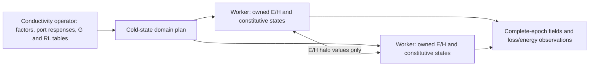

# Experimental compact-domain execution

This is a scoped C++ core interface. The
[canonical checklist](CARTESIAN_SUBGRID_CHECKLIST.md) separates implementation
from physical backend, processing and representative-antenna qualification.
The [native CLI/Python adapter](CARTESIAN_SUBGRID_RUNTIME.md) now selects fixed
local workers separately from geometry XML. Its qualification and unsupported
runtime controls are recorded separately from the C++ contract below.

The bounded C++ lane additionally has physical RTX4090/RTX3080 pair evidence
in [Physical mixed-device contexts](#physical-mixed-device-contexts). This does
not by itself qualify native distributed execution; the later native evidence
is recorded in the linked runtime document.

## Streamed global domain preparation

Cold plans now read exact compressed global curl/transpose patterns instead
of first allocating both expanded CSR operators. Ghost discovery and local
row remapping preserve global IDs, local numbering, operand order and FP32
high/low coefficient bits. All four plan constructors use this path, including
the separately prepared loss/PML combination. `CurlPreparation::ExpandedOracle`
retains the previous expanded input for independent setup controls. Individual
domain upload arrays and numerical update kernels are unchanged in R19.
The subsequent local-pattern increment below changes the default local
preparation representation while retaining the same numerical kernels.

Six graded, multi-region/material/PEC/port cases per backend compare complete
local metadata, halo transfers and256-step fields exactly against that oracle.
Reference and physical Metal pass, as do actual native Python TD/FD/U/I
controls (8 reference/16 Metal cases) and all45 CTest cases. The local core is
`560fa47d714b125f0f9417f06692969422e64745da0eef732055033bef8d7fbb`.
The original R19 CUDA test stops before backend creation because its test
fixture configures resistors after soft sources. That is a fixture error, not
an engine failure. An audit also found that the local R19 test binary preceded
the final port-fixture edit; its claimed match to that final test source is
superseded. The corrected test, compiled from a fixed source snapshot against
the unchanged R19 core, separately passes six reference/six Metal metadata and
field cases with ports. The retained native Python port controls are independent
evidence. The original CTest replay is not a fresh execution of this corrected
fixture. Physical R19 acceptance remains open; the earlier R18 matrix does not
qualify changed preparation code automatically.

Three interleaved setup-only repetitions on the same Mac compare491,520
leaves and three domains against the actual frozen R18-r02 runtime
(`b0b157b27840bde3debef17ff1f914c8b9a049905dbed9b7716059fd8a404de4`).
Both retain the same owned/ghost counts, local terms and timestep. Medians:

| Quantity | Frozen R18-r02 | Global stream |
|---|---:|---:|
| Peak process RSS | 1,231,798,272 B | 940,146,688 B |
| Domain-plan preparation | 0.3204 s | 0.4417 s |
| Grid plus domain-plan preparation | 1.1739 s | 1.2921 s |

Peak RSS decreases23.68%; whole setup takes10.07% longer. This is a memory
tradeoff, not a timestep or production speedup. Smaller25,920/120,000/207,360
leaf cases separately preserve exact counts and show lower peak memory.
The first standalone benchmark compile omitted the existing Boost include
path; its failure is retained separately from the corrected measurements.

Reproduce the setup-only harness with `benchmark/subgrid_domain_setup.cpp`,
using `streamed` or `expanded`, a size up to64 and a worker count. Link against
matching headers/library; the frozen-parent comparison uses its original
three-argument plan constructor. The evidence archive is the separately
identified `domain-stream-r19` study. No production runtime, allocation guard,
physics, geometry, source or frozen antenna is changed. Per-domain expanded
uploads, per-state hash maps, global host fields/topology and general large
interfaces still prevent claiming production-scale readiness.

## Streamed local domain preparation

R20 prepares each worker's exact translated row patterns directly, without
retaining local expanded CSR arrays or repacking them in the backend.
`CartesianSubgridDomainData::operators` owns the prepared patterns; backend
construction borrows them only for upload. `fields.streamCurls` distinguishes
this package from the retained `ExpandedOracle` local arrays. Global/local
IDs, row order, split coefficient bits, owned/ghost fields, loss/PML histories
and numerical update kernels remain unchanged. The GPU package matches the
old expanded constructor's arrays exactly; this is not a new spatial kernel.

Before GPU allocation, validation checks dimensions, prefix bounds, pattern
and column ranges, integer addition overflow, finite/normal scalar values and
the absence of conflicting spatial/expanded data. Thirteen malformed package
controls reject without allocating GPU memory. Six reference/six Metal cases
compare exact compressed metadata, transfers and256-step port-driven fields
against the expanded oracle. Actual native8/16-case reference/Metal TD/FD/U/I
controls and the fresh45/45 CTest replay pass. The complete R20-r03 source was
hashed before compilation and rechecked after the build and tests.

Local R20-r03 core SHA256:
`65309099920fd3f93e5e039ffde808ed77fb520910d9f1c17d672f1ce7de39c7`.
Physical CUDA qualification passes14 gates and CTest45/45 on the
RTX4090/RTX3080 pair, including both orders,24 exact metadata/field cases,
13 malformed-package guards and16 native Python TD/FD/U/I cases. Terminal
source/runtime hashes are rechecked; CUDA core SHA256:
`d22631691f0a4a38b756f279ef27673adfe52e7d0373af47c99e9786c04f94cf`.
The original R19 fixture/source-binary audit remains preserved above; R20's
test contains the corrected resistor-before-source ordering.

Three interleaved setup-only repetitions against the actual frozen R19 core,
491,520 leaves/three domains, with identical counts and timestep:

| Quantity | Frozen R19 | Local patterns |
|---|---:|---:|
| Peak process RSS | 943,341,568 B | 656,818,176 B |
| Domain-plan preparation | 0.4508 s | 0.5392 s |
| Grid plus plan preparation | 1.2900 s | 1.3923 s |

Peak RSS decreases30.37%, with7.93% longer complete setup. A nonuniform,
two-material61,440-leaf control shows only2.88% lower peak RSS
(179,437,568 to174,276,608B), with10.49% longer complete setup. Compression
benefit depends on coefficient repetition; neither case proves a universal
memory or performance factor.

A separately bounded setup-only control reaches960,000 leaves, with a median
peak RSS1,255,030,784B, below its1.5GiB process cap. This does not test FDTD
evolution, RF accuracy or antenna suitability at that size. The one-million
cell guards, per-state hash maps, global host topology/fields, magnetic
quadratures and general interface scaling remain unchanged. Evidence is the
separately frozen `local-domain-stream-r20-r03` study; no production runtime
or antenna is modified.

## Shared owned-state domain addresses

R21 replaces each worker's owned-state hash entries with one shared direct
local-address slot per global electric/magnetic state. Per-worker hash maps
retain only ghost entries. Ownership is finalized before lookup construction;
shared slots and owners outlive all maps during serial preparation. The
constitutive owned-only view rejects ghost access. `ExpandedOracle` retains
independent full hash maps. No fields, arithmetic, row order, histories,
transport or backend update kernels change.

The focused map oracle checks10,007 states and1,818 ghosts, duplicate/missing
addresses, invalid dimensions/IDs and strict owned-only access; it stores1,818
hashed entries instead of11,825. Sanitized preflight passes. Six reference/six
Metal exact compressed-metadata/256-step port-field cases, native8/16-case
TD/FD/U/I controls and fresh CTest46/46 pass on a complete source snapshot
fixed before compilation. Local core SHA256:
`368bd107b338abe898716849052def0785ac80eb501882842022b3b4567f4367`.
Physical CUDA qualification passes14 gates/CTest46,24 exact metadata/field
cases,13 malformed-package guards, both4090/3080 orders and16 actual native
Python TD/FD/U/I cases. Terminal source/runtime identities are rechecked.
CUDA core SHA256:
`17fc5908b93bf032b0219ceb5c7acb7e1b26cf3b6c723dc5acbc71758e64f8f0`.

Three interleaved setup-only repetitions against the actual frozen R20-r03
library preserve owned/ghost counts, logical term counts and timestep:

| Case | R20 peak RSS | R21 peak RSS | Whole-setup change |
|---|---:|---:|---:|
| Uniform491,520 leaves/three domains |657,801,216B|495,206,400B|−9.78%|
| Graded two-material61,440 leaves |175,144,960B|158,023,680B|−7.47%|

Uniform peak RSS falls24.72%; domain-plan time falls22.55%
(0.5163→0.3999s). The graded memory reduction is9.78%. A960,000-leaf
setup-only control has median peak RSS931,610,624B, below the retained1.5GiB
process cap. These do not establish FDTD speed, large-grid evolution or antenna
accuracy. The first extra benchmark's CSR-only parent term counter correctly
triggered its equality guard; logs are preserved and the corrected identical
logical-term accounting was repeated. Source/runtime numerics were unchanged.
Evidence: separately frozen `domain-address-r21` study. Cell/interface guards,
global reference fields/topology and magnetic quadratures remain unchanged.

## Lazy serial reference workspace

R22 keeps CPU-only curl/increment/source-copy work empty during cold device
preparation. Serial E/H sweeps allocate the needed vectors on first use and
reuse their capacities. The conductivity engine likewise defers its old-E
and source-curl scratch; physical host mirror fields, surface/material history,
operator coefficients, ownership and update kernels are unchanged.

A focused control prepares device fields/operators and a cold domain plan
without growing reference work, rejects invalid timesteps/phases without
allocation, then verifies first-use allocation and stable capacity through100
CPU steps, with and without ports. Twelve reference/Metal exact compressed
metadata/field cases, native8/16-case TD/FD/U/I controls and fresh CTest47/47
pass. The full source was fixed before compilation and rechecked afterward.
Local core SHA256:
`4404bf43382c6ee10504630b344a10d243adbc78efae50300d0bb6bda6ca5484`.
The separate physical CUDA qualification passes14 gates/CTest47,24 exact
metadata/field cases,13 malformed-package guards, both4090/3080 orders and
16 actual native Python TD/FD/U/I cases. The first-use reference-work test
passes in that fresh replay. Terminal source/runtime identities are rechecked.
CUDA core SHA256:
`778c6ee7478fc284889a0c26acc5a4f233cc06a0486b8d37c39c10f25db7fb14`.

Three interleaved setup-only repetitions against actual frozen R21:

| Case | R21 peak RSS | R22 peak RSS | Accounted cold grid |
|---|---:|---:|---:|
| Uniform491,520 leaves/three domains |498,040,832B|462,979,072B|218,385,216→183,337,536B|
| Graded two-material61,440 leaves |172,392,448B|158,302,208B|41,560,188→37,221,372B|

Cold accounted storage drops by exactly8bytes per owned E/H state in these
lossless fixtures. Peak RSS drops7.04%/8.17%; whole setup changes−1.88%/−3.95%,
while graded plan time increases5.88%. No FDTD throughput improvement is
claimed. CPU execution still requires its scratch; it is deferred, not removed.
The additional constitutive scratch savings are not measured by these lossless
setup cases. A960k-leaf setup-only control has median peak RSS858,390,528B.
Evidence: frozen `reference-work-r22` study. No cell/interface guard, production
runtime, antenna input or RF qualification changes.

## Ownership, workers and transport

`CartesianSubgridDomainPlan` assigns fixed ownership from one axis and a list
of increasing internal coordinate cuts. Cuts assign work; they do not create
mesh faces. Up to 64 nonempty domains are admitted. All six magnetic
quadratures of a leaf stay together. Each coupled electric mass component
belongs entirely to one worker, so geometric assignment may move electric
edges across a cut. The plan records that count. This avoids splitting a
coupled solve; it does not guarantee balanced work.

The subsequent coupled-port increment also co-locates the complete small
Woodbury solve, its voltage/response supports and every touched mass component.
Other owned states remain distributed. This preserves the already qualified
port arithmetic; independently splitting port clusters is not implemented.

Each worker has owned-first local E/H arrays followed by read-only ghosts.
Local row remapping retains the exact operand order and split coefficients.
Ghost dependencies may fan out or cross non-neighbour workers. Only unique
owned export values are gathered, downloaded and copied into preallocated
receive buffers, then contiguous ghost ranges are uploaded. No whole-field
transfer is performed at every half-step. The plan now streams global and
local compressed rows during setup; expanded arrays remain an explicit oracle.
Production-proportional setup memory and structured interiors remain open.

The coordinator knows only worker and transport interfaces. GPU handles and
local gathers/uploads belong in the local worker adapter, not the scheduling
logic. A reference worker runs on the CPU; this is not integration with the
optimized production CPU engine. Remote workers, MPI/RPC and asynchronous
transports are future adapters, not implemented capabilities.

At epoch n, exchange H before the E update; then exchange E at n+1 before the
H update. Workers reject missing/wrong-phase ghost acknowledgements. Full-step
observations read owned fields and scatter each global state exactly once.
Queued epochs are logical submission state, not device fences; export/owned
reads and ghost uploads finish before returning. Errors after a submission
poison the coordinator so it cannot silently continue a partially changed step.
There is no single borrowed device-field buffer for the whole domain run.

Use `FDTD/cartesian_subgrid_domains.h` from matching source headers. For example,
`CreateCartesianSubgridDomains(plan, backends)` builds local workers and a
host-staged transport. The more explicit worker/transport/coordinator factories
permit alternate adapters without putting communication choices in the core.
Backends must outlive workers. The optional `DeviceUpload` backend operation
fails closed before worker allocation when unsupported; the existing one-device
factory remains usable. This changes C++ layouts/vtables: rebuild dependent
callers/plugins with matching headers. Built-in backend tests do not qualify
plugin mode or Windows symbol export.

## Qualification scope

The [domain regression](tests/test_cartesian_subgrid_device_domains.cpp) covers
one through four logical domains, XYZ cuts, separate regions, anisotropic
ratios, nonuniform meshes, a lossless dielectric step, PEC and soft sources.
It compares complete fields with the existing one-device FP32 execution and
double CPU reference over 1500 steps. It also checks actual transfer payloads,
stale/missing exchanges, poisoned continuation, invalid uploads and unchanged
one-device operation when upload capability is absent. Physical backend
requests reject fallback rather than accepting a reference result.

The immutable local suite passes all 19 stages: CTest 23/23, Python unit modules
14/14, the prior native CPU/reference/Metal fields, ports/DC, PML, dipole,
polygons and ordinary-engine controls. Thirteen previous core/NF2FF prefixes
remain unchanged; 11,255 numerical arrays equal the frozen larger-interface
build exactly. Seven reference cases and eight physical Metal cases pass,
including mixed CPU-reference/Metal workers. Across these 1500-step domain
controls, one-device fields are identical and maximum double-reference error
is 1.62522e-6 (gate 2e-4). Missing/stale exchanges and poisoned continuation
reject. A separate ASan/UBSan domain-source control passes; LeakSanitizer is
unsupported on this macOS and no leak-sanitizer claim is made.

A separate 360,424-leaf control exercises an actual 16,384-edge mass component
across two logical Metal domains on one M5 Pro: base 8194/4/4, spacing
0.001/0.0013/0.0009m, region (2,1,1)–(8192,3,3), ratio 2/2/2 and an X cut
at 4.097 m. After 256 steps at 0.8 of the stable timestep, the one/two-domain fields
are identical, double error is 1.02301e-6 and invariant drift 1.18914e-9.
Some 32,772 electric states move owner to preserve whole coupled components.
These are functional controls, not a scaling benchmark.

Frozen local prefix: `output/openems-subgrid-domains-qualified-20261115/install`.
Configure-time source parent is `1a8f48f`, with this domain increment. Exact
source inventories, logs and identities remain in the project evidence tree:
`experiments/openems-cartesian-local-subgrid-20261112/domains/`.

- Core SHA256: `ebb022b5539b336a6b4b43b06bc1e83744b3a657ebd77d8bbb3e10489648ba53`.
- NF2FF SHA256: `87890b7ed62795695b7f81e15e3453f3c789c4f75821e5508bb1157c869c27ef`.

The same numerical source passes eight logical-domain controls on one physical
RTX3080, including mixed CPU-reference/CUDA workers, through existing HIP/nvcc.
One-device errors are zero; maximum double error is 1.62522e-6. CTest 23/23 and
single-device fields/ports/DC pass. The first attempt hit an external 300 s
CPU-test deadline; the second retains identical source/runtime/gates, runs CUDA
first and allows 900 s for CTest. Both attempts remain recorded. The final container
exited 0 without OOM, and final source/runtime hashes match. This does not
qualify physical multi-GPU, domain ports/PML or native CAD CUDA paths.

- CUDA core SHA256: `de9994d3e5a09f07de74de1effed5cc9c6371d2d7ee28bd0204d8ccdeab56c0a`.
- [CUDA reproduction scope](CARTESIAN_SUBGRID_CUDA.md#scoped-logical-domains-on-one-rtx3080).

All existing total-cell, interface-factor and refinement-alignment guards
remain. Unsupported imported non-port ledger history and malformed port
metadata reject explicitly. The original lane above did not implement PML, bulk losses/conductors,
DFT/NF2FF, collective pause/resume or native processing. The later
[prepared-conductivity increment](#prepared-conductivity-domains) extends only
its explicitly tested cold C++ constitutive path. One-device tests do not imply
broader distributed support. No throughput, representative PCB accuracy or physical
multi-GPU claim follows from logical domains on one physical device.

## Coupled resistors and source ledgers

Configure-time parent `15daf56`; the physics, source ordering and shared
point operations are unchanged. The plan retains all port rows, responses and
the small factor on one owner, with a common fixed port timestep. The initial
accumulated ledger is attributed once. A worker without a local port still
records its soft-source work using the original mass neighbours and unsolved
curl. Per-owner complete-step reads sum losses/work without copying full
fields each half-step. A partial-step ledger read rejects.

[Port-domain controls](tests/test_cartesian_subgrid_device_domain_ports.cpp)
compare three uneven logical domains with one FP32 device and double CPU:
50/75-ohm resistors, Norton drive, source-only workers, mass-coupled/repeated
soft kicks, warm accumulated history, strong DC and repeated observations.
All XYZ cuts and mixed CPU-reference/GPU workers are covered. Malformed
responses/conductances, wrong timestep and ledger phase reject. Unsupported
imported non-port history must reject instead of disappearing.

All 20 local qualification stages pass: CTest 24/24, Python modules 14/14,
retained native CPU/reference/Metal ports/DC, PML, dipole, polygons and ordinary
engines. Fourteen older runtime prefixes remain unchanged; 11,255 arrays equal
the frozen domain build exactly. Five reference and six physical Metal
port-domain cases pass. One-device fields are identical; maximum double field
error is 1.94051e-5 and energy-balance error 1.70516e-6 (gates 2e-4). Separate
ASan/UBSan domain-source controls pass; no LeakSanitizer claim.

The same numerical source passes six port-domain cases on one physical RTX3080,
including mixed CPU-reference/CUDA workers, with identical one-device fields
and the same error bounds. CTest 24/24 and retained CUDA fields/ports/DC also
pass; final source/runtime and terminal checks pass. This is three logical
workers on one physical GPU, not three physical GPUs or native distributed RF.

Frozen local prefix:
`output/openems-subgrid-domain-ports-20261116/install`.

- Core SHA256: `e2625eed13c24b9c5c07819fcc9015d0998e317a39da895adc66c5902ac00eb1`.
- NF2FF SHA256: `74c23472937c94c5c8731d9c34b0bdb8b19d8b4f7b4447e8dadd767c6af5e6bd`.
- CUDA core SHA256: `f9af217240707dba76822509402fd835c5a5a47cbbf10e4eef121d79096ef0de`.

Exact source/runtime identities, failed/passed observations and compact evidence
remain under `experiments/openems-cartesian-local-subgrid-20261112/domain-ports/`
in the project study. This does not qualify native domain selectors, distributed
PML/loss/DFT, physical heterogeneous devices, broader sources/modal ports,
production scaling or representative antenna accuracy.

## Physical mixed-device contexts

Configure-time parent `458e612`. Inspection and a four-byte physical diagnostic
showed a missing context boundary in this experimental adapter: after creating
two HIP backends on one host thread, an allocation through backend 0 belonged
to device 1. This is not a defect claim against upstream's single-device
execution contract. The frozen failing library and input are preserved.

`GPU_Backend::Activate()` selects the backend's device before a host batch.
The compact executor uses it for setup, E/H updates and observations; the local
worker uses it for halo reads/uploads and owned-field observations. HIP calls
`hipSetDevice` without adding an explicit synchronization. Reference and Metal
need no ambient selection. HIP cleanup selects the owning device too. This
adds no device-specific logic to the coordinator or transport, changes no
shared numerical operations and leaves ordinary engine loops unchanged.
Callers using the raw backend API across devices must select the matching
backend before each batch too. This is not a thread-safety guarantee for
concurrent use of one backend. Rebuild plugins and C++ clients with matching
headers/build identities.

The actual physical pair is one RTX4090 and one RTX3080, through the existing
HIP/NVIDIA backend, nvcc, SM86/SM89 and retained safe arithmetic. The diagnostic
now verifies allocation ownership and distinct readback on both devices.
The domain controls also include a deterministic ambient-context guard that
runs without a GPU. Both physical device orders pass nine field/domain and
six coupled-port cases each; a retained single-device lane passes the same
cases. Uneven cuts, XYZ, separate anisotropic regions, PEC, CPU/GPU mixtures,
source-only workers, warm ledgers, strong DC and stale/poisoned exchange guards
are retained. Fields equal the single-device control exactly, maximum double
error is 1.94051e-5, and maximum balance error is 1.70516e-6 (gates 2e-4).
CUDA CTest 24/24 and existing fields/ports/DC controls also pass, with final
source/runtime checks and container exit 0/no OOM.

All 20 local CPU/reference/Metal compatibility stages pass, including CTest
24/24, Python 14/14, native fields/ports/PML/dipole/polygons and ordinary
engines. Fifteen older core/NF2FF prefixes are unchanged, and 11,255 arrays
equal the frozen coupled-domain-port build exactly. The separate ASan/UBSan
domain-source test passes; the linked grid/library is not instrumented and
LeakSanitizer is not claimed.

A separate warmed host-only microbenchmark reports median 0.0692 microseconds
for selecting the same device and 0.0804 microseconds for alternating devices
(five rounds of 20,000 calls). It measures neither kernel execution nor
end-to-end FDTD overhead. Tests shared the hardware with an active simulation;
there is no throughput or scaling claim.

- CUDA core SHA256: `a00cf838a52f600069f1f1c9a79b3775ab40deb39760bfcc23fe581bfeb8578f`.
- Frozen local prefix: `output/openems-subgrid-physical-two-20261116/install`.
- Local core SHA256: `bc4ba82aad1f3821fbf94f68dee1983cc014a69f20df71075c1becf0959bdb29`.
- Local NF2FF SHA256: `72d50787ac38006375363a333cfae19d14ad27d2bb8772017aa1ab16aaa4d553`.
- Isolated source/build and compact evidence:
  `experiments/openems-cartesian-local-subgrid-20261112/physical-two/` in the
  project study, including the preserved failing diagnostic and terminal gates.
- Native selectors, domain PML/material histories/conductors/DFT/NF2FF,
  collective pause/resume, proportional setup memory and representative antenna
  qualification remain open. No active/frozen antenna runtime is replaced.

## Prepared conductivity domains

The r13 increment extends the bounded **C++** lane through typed conductivity
preparation. Its bounded reference/Metal and physical RTX4090/RTX3080
controls pass; it does not enable native distributed scripting,
absorber/DFT histories, collective runtime controls or antenna workflows.

The plan retains each complete implicit electric mass component on one owner.
Every conductance/surface trace must have support within that ownership; an
RL pole belongs to exactly one worker. Magnetic rates follow the six owned
quadratures of each leaf. Local recurrence views exclude ghost entries, so
constitutive operations cannot overwrite halo storage or overrun the owned RHS.
Remapping preserves operand/branch ordering and prepared coefficient pairs.
No constitutive state is exchanged or duplicated between workers.

Single-device preparation still streams curls; domains retain the existing
expanded setup representation. This changes neither the physical equations nor
the surface fits and does not solve proportional setup memory or performance.
Ports still retain their complete coupled solve on one owner. Source-only
workers record their work using the original mass and unsolved curl.

A plan may be constructed from an unadvanced
`Engine_Ext_CartesianSubgrid_Conductivity` rather than a bare grid. Its typed
package binds effective factors, resistor responses and constitutive tables
from the same preparation. Warm CPU/device histories, pending host half-steps
and additional unprepared extensions reject. This is cold initialization,
not state migration or checkpoint restart. The recurrence timestep is checked
by the coordinator before any exchange/submission, and workers must advertise
the matching prepared capability.

After a complete step, call `ReadFields(grid)` and then the paired extension's
`ReadDeviceDiagnostics(device)`. Separate complete-epoch observations expose
bulk electric/magnetic loss, surface Ohmic loss and instantaneous stored branch
energy. Summation across owners is double precision; bit-identical ledger
reduction is not promised. Partial-epoch reads reject. These new C++ layouts
and worker virtual methods require matching rebuilt callers/plugins.

[Constitutive-domain regression](tests/test_cartesian_subgrid_device_domain_loss.cpp)
checks eleven two/three-domain controls over 768 steps: XYZ assignment cuts,
zero/electric/magnetic/combined/surface-only losses, constrained traces, separate
history owners, pure-inductor branches, repeated soft kicks, source-only workers
and 50/75-ohm resistors. Three 512-step controls use native CSX copper volumes
at 18/35 micrometres with and without a lossy dielectric. The reference backend
matches one-device FP32 fields exactly; maximum double-reference field error
is 5.830e-6, constitutive ledger error 7.389e-8 and energy-balance error 2.638e-7,
within the retained 2e-4 CPU/physics gates. Full local CTest passes41/41.
Wrong timesteps, partial epochs, malformed recurrence dimensions, ghost columns,
warm preparation and unprepared absorbers reject.

Candidate prefix: `output/openems-subgrid-distributed-loss-r13-20261116/`.
Installed local core SHA256:
`f355d86377b742520112925f8f38cd0dfeed66c3724510a477254b865f6bf880`.
Source parent is `9eb7291`; the candidate's numerical source/build are locked
while physical tests run. Compact evidence remains in
`experiments/openems-cartesian-local-subgrid-20261112/lossy-materials/distributed-loss-r13/`.
The composed local replay passes19 stages, CTest41/41 and Python14/14,
with11,255 prior arrays unchanged. Fifteen Metal cases include mixed
CPU-reference/Metal workers. The physical CUDA replay passes39 gates and
CTest41/41: fifteen constitutive cases on each physical GPU and fourteen on
the RTX4090/RTX3080 pair in each order. All58 CUDA constitutive comparisons
retain identical one-device FP32 fields; maximum double field/ledger/balance
errors match the bounds above. Terminal source/runtime checks pass and the
bounded container exits0 without OOM. These are functional controls alongside
an active antenna; no speedup, general scaling or peak-VRAM claim follows.

CUDA core SHA256:
`21ab8476d5ba7845e6518bdc00743cbe3e947ffa57ea851872eb3cfc8a64c83f`.
Native distributed selectors, PML/Mur histories, DFT/NF2FF and collective
pause remain open, as do RF convergence and representative antenna acceptance.

## Prepared PML domains

The r16 C++ candidate adds constructors from a cold paired PML engine, either
alone or with its explicitly identified conductivity engine. Unknown companion
extensions, unrelated grids, prior host advance (including zero fields), live
device state and incompatible timesteps reject. The existing loss/PML support
separation remains enforced; this is the prototype's classical convolution
PML, not ordinary UPML/CFS parity or live history migration.

Every complete same-target derivative group is assigned to its E or H owner.
Required derivative inputs add field ghosts before transport construction.
Convolution histories, corrections and signed-work states never become ghosts.
The worker executes PRE/core/POST/APPLY before exporting each half field. The
coordinator's complete-epoch `ReadBoundaryWorkOut()` sums signed work; it is
neither nonnegative dissipation nor radiated power. Material/source/port ledgers
remain separate. Worker capabilities and the exact recurrence timestep are
checked against the plan before advancing.

Use the worker/coordinator factories to compose PML hooks. The internal compact
core-execution helper alone is not a complete PML/native engine. Native
distributed XML/Python selection, processing/DFT/NF2FF and collective runtime
control remain unimplemented. The changed C++ interfaces require callers and
GPU plugins to be rebuilt together. No production/frozen runtime is replaced.

The focused test passes6 reference and7 Metal cases, including deliberately
mixed reference/Metal workers on one M5 Pro. It covers all partition axes,
two-face and six-face/corner absorbers, two/three uneven domains, disjoint
bulk/surface losses, ports and sources. Same-target history counts are retained;
ghost-owned histories, half-step observations, a different-grid pairing and an
already advanced zero-state PML reject. FP32 fields match one-device controls
exactly; maximum double field error is1.420e-5 and normalized signed-work/energy
balance error is below4.387e-8. All43 local CTest controls pass.

Local core: `71bb756fcf84001a36eec6027e4c4f3a97cfc3cff337ad0d2262c2cb2f3ac3d6`.
The broader20-stage local replay now passes CTest43/Python14 with11,255
unchanged prior arrays. The R16 CUDA replay fails in the first physical pair
PML case after35 retained gates pass: the compact PML hooks relied on a caller
leaving their owning device current. This experimental context defect is
corrected by the separately built r17 follow-up below. R16 is not qualified
for physical paired PML. Representative antenna and production scaling remain
open; the larger D/B/F/U/A checklist items are retained.

## Compact PML owning-device correction

The r17 PML component activates its backend before allocation, every hook and
work download. An interleaved worker may leave a different context current;
callers no longer have to restore it before entering PML. The original R16
pair failure and immutable source/runtime identities are retained. This fixes
the experimental compact adapter, not an established ordinary-UPML defect.

The strengthened regression intentionally selects another worker before every
single-device PML operation. Equations, order and thresholds are unchanged.
All20 local stages, CTest43/Python14 and11,255 exact prior arrays pass. Five
physical RTX4090/RTX3080 PML controls pass in each device order, including
losses, sources and ports. Full physical CUDA replay passes43 gates and
CTest43/43, including24 PML and58 constitutive comparisons. Terminal source/
runtime checks pass; the bounded container exits0 without OOM. This does not enable native distributed scripting or DFT/pause.

Local core: `5222750a352def4826d688f988f6f640ba73616370ea500d8eb3b1f0cc641f4b`.
CUDA core: `cefb3f88291dadd7791e3854f048a55f221b7a69c0d2ea5bf09f4382b88a72dc`.
No frozen/production runtime, antenna input or allocation guard changes.

## Native local execution

The r18 adapter now connects the checked cold domain plan to normal CLI and
Python runs, including paired PML/loss diagnostics and complete-batch host
processing. The [native runtime contract](CARTESIAN_SUBGRID_RUNTIME.md) records
configuration, source/build identities, actual scripting/Metal/CLI/RF/NF2FF
controls, the R02 `none` correction and pending physical CUDA qualification.
This is local native execution; it does not add remote worker management,
external collective pause or production/representative-array qualification.

## Direct canonical rows and incoming-face addresses

R26 removes the temporary global FP32 curl/transpose pair from streamed
domain preparation. `CurlRow` reads the owning grid's canonical double row
into reusable caller storage. A setup-only incoming-face index retains exact
ascending transpose order with shared integer-offset patterns; an allocation
gate keeps owned raw CSR instead when smaller. The temporary cursor and,
when compressed, raw CSR are released before local packages are built.
No coefficient is approximated, field/history ownership changed or kernel
updated. The expanded path remains an independent oracle.

Linux GPU-free controls pass CTest50/50,16 exact actual-parent operator and
512-step field files,12 coefficient cases,6 exact domain cases and8 native
TD/FD/U/I cases. Thirteen physical CUDA gates pass on the RTX4090/RTX3080
pair:24 exact domain cases, both pair orders, retained loss/PML controls and
16 native cases. Source/runtime hashes and actual exit0/no OOM are rechecked.
CUDA core SHA256:
`af2f565365bc1e8d1fee55ad43168f05821035b00da368f1333bfb4452b62610`.
Metal remains pending; no platform pass is inferred from another backend.

Three interleaved repetitions compare actual frozen R24, R25 and R26:

| Case | R24 peak RSS | R25 peak RSS | R26 peak RSS | R26/R24 whole setup |
|---|---:|---:|---:|---:|
|Uniform491,520 leaves|364,580,864B|378,351,616B|336,912,384B|+10.92%|
|Graded two-material61,440 leaves|118,181,888B|96,686,080B|91,443,200B|−11.92%|
|Uniform960,000 leaves|681,447,424B|703,909,888B|625,590,272B|+2.39%|

Whole setup uses medians of actual combined grid/plan intervals. R26 reduces
peak RSS against both prefixes, but is not a general setup/FDTD speedup.
Permanent grid bytes, local terms, owned/ghost counts and timestep agree.
The earlier R25 memory regression and all frozen prefixes remain preserved.
Actual full-array scaling, large interfaces, global fields/observations and
production resource savings remain open; no allocation guard is increased.

## Implicit incoming curl support

R29-r02 removes the global incoming-face CSR from streamed domain preparation.
`CartesianSubgrid::CurlTransposeRow` derives the at-most-four incident base
roots from one independent electric edge's integer address, enumerates bounded
local support, and reads the original normalized double curl rows. It retains
explicit zero terms and ascending face order; coefficients, field IDs, owner
choices and numerical updates do not change. Invalid indices and incomplete
steps fail before changing caller storage. Current separated, non-nested
powers-of-two<=16 topology limits remain. The expanded oracle and the standalone
R26 incoming-index controls are retained; default streamed setup no longer
allocates a global incoming CSR or accumulates its total terms in uint32.

Twenty-four all-row controls compare74,780 rows/625,360 terms exactly against
the independently expanded transpose: both layouts, graded cells, mixed
regions, full fine, PEC/PMC/opaque, native unequal child knots, factor16 in
individual axes and XYZ refinement. Two original fixture failures are retained:
an invalid magnetic-before-electric call and an opaque slab at an unsupported
coarse/fine trace. Separately corrected tests pass on the unchanged numerical
library before inclusion in a fresh source-before-build prefix.

The exact promoted numerical/test source passes Linux CPU54/54,16 exact
actual-R28 operator/field files, eight native reference and six exact domain
cases. Eighteen physical CUDA gates pass on4090/3080, including both pair
orders,48 child-coordinate cases,24 exact domain cases and16 native Python
cases, retained loss/PML controls and a separately hashed native E/H driver.
Source/runtime/raw/driver hashes and terminal exit0/no-OOM were independently
rechecked. Physical Metal, full-array scaling and RF convergence remain open.

Three interleaved repetitions use actual frozen R26/R28 libraries. Results
below compare the immediately preceding R28; permanent grid storage and
field/ghost/term counts are unchanged. R26's object-size difference is measured
explicitly rather than mistaken for dynamic-grid allocation.

| Fixture leaves | R28 peak RSS, bytes | R29 peak RSS, bytes | RSS change | Whole setup change |
|---:|---:|---:|---:|---:|
|491,520 uniform|337842176|325898240|−3.54%|+8.84%|
|61,440 graded|91967488|89870336|−2.28%|+9.09%|
|960,000 uniform|625360896|601460736|−3.82%|+18.90%|

This is a modest peak-memory improvement with slower CPU preparation, not a
general speedup. Removing that global allocation/term-count limit is necessary
for larger streamed plans but does not admit them: allocation/interface guards
remain. Combined registration with the separate R30 loss fixture is exercised
by the separately qualified R31 source, not relabelled as this54-test run.
The metadata-only initial-field-copy candidate remains separately unqualified.

## Tiled domain ownership labels

R31 changes only setup ownership-label storage. A uniform256-state tile stores
one worker ID; mixed tiles store exact byte labels for at most64 workers.
Global field IDs, local addresses, port/interface reassignment and coefficient
operations remain unchanged. The expanded oracle keeps dense uint32 labels.
Thirty size/pattern controls verify labels, owning copies, bounds and rejected
mutations;11,827 direct-map lookups agree with the dense oracle. These compact
label bytes alone are not a whole-plan memory prediction.

The exact promoted source passes CPU56/56,16 exact actual-R29 files, native
reference observations and the combined R30 native child-loss registration.
All22 physical CUDA gates pass on the actual4090/3080 pair in both orders,
including24 exact metadata/field domain cases,48 native child-coordinate
cases,58 native child-loss cases and16 native Python TD/FD/port cases. Runtime,
source, raw files and terminal exit0/no-OOM were independently rechecked.

Three interleaved repetitions compare actual frozen R28/R29/R31 prefixes;
the table reports change against the immediately preceding R29.

| Fixture leaves | R29 peak RSS, bytes | R31 peak RSS, bytes | RSS change | Whole setup change |
|---:|---:|---:|---:|---:|
|491,520 uniform|325894144|308592640|−5.31%|+2.36%|
|61,440 graded|90390528|87769088|−2.90%|+4.73%|
|960,000 uniform|601464832|568954880|−5.41%|+3.69%|

These are measured preparation-memory reductions with slightly longer setup,
not FDTD speedups. Global owned-index arrays and initial host fields remain in
this revision. Subsequent R32/R33 candidates require independent acceptance.
Metal, full-array scaling, RF convergence and production adoption remain open;
no allocation, interface, numerical or resource guard is increased.

## Metadata-only initial state preparation

R32-r02 removes global temporary FP32 E/H copies from streamed domain
preparation. A metadata-only preparation scans the complete global electric
then magnetic double state in the unchanged order, retaining identical
underflow, maximum, L1, significant-tail and finite/range checks. It does not
recompute a separate FTZ allowance per worker or double-count ghosts. A const
constructor converts the existing double state directly into each owned/ghost
package. The source grid remains unmodified; no borrowed state escapes the
constructor. Expanded and single-device APIs retain their owning field copies.
No field update, kernel, coefficient, timestep or source arithmetic changes.

The original frozen R32 build failed because a boolean was placed in the
public domain-data structure rather than private Prepared metadata. The
separately frozen r02 changes only that header placement before building; the
failed source and compile log remain preserved.

Sixteen metadata/tail controls require exact owning-oracle metadata, global
FTZ ledgers and per-domain initial values, including signed zero, tiny tails,
all-underflow, overflow, nonfinite and half-step rejection. Full CPU57/57,16
exact actual-R31 operator/field files and native observations pass. All22
physical CUDA gates pass on the actual4090/3080 pair in both orders, including
24 exact domain cases,48 child-coordinate cases,58 native child-loss
compositions and16 native Python cases. Terminal exit0/no-OOM and actual
source/runtime/raw identities were independently reviewed.

Three interleaved repetitions compare actual R29/R31/R32-r02 prefixes. The
table reports the immediately preceding R31. Permanent grid storage, field
IDs, coefficients, owner choices, ghost counts and local term counts are equal.

| Fixture leaves | R31 peak RSS, bytes | R32 peak RSS, bytes | RSS change | Whole setup change |
|---:|---:|---:|---:|---:|
|491,520 uniform|308965376|291012608|−5.81%|+0.23%|
|61,440 graded|87764992|85372928|−2.73%|+0.34%|
|960,000 uniform|569307136|534880256|−6.05%|+3.08%|

These are preparation-memory measurements, not FDTD throughput claims. Full
double host fields, global address storage and all local upload packages still
exist. Metal, full-array memory/interface scaling, curved RF convergence and
antenna qualification remain open. Allocation/resource guards stay unchanged.

## Immutable owned local ranks

R33 removes mutable global uint32 owned-address arrays from streamed plans.
The index owns finalized labels and assigns each state's exact local owned
rank in ascending global-ID order. Uniform256-state tiles store one uint64
local base; mixed tiles retain exact uint32 ranks. A two-pass byte preflight
chooses dense ranks when smaller, checks actual capacities and releases any
rejected packing reservation before fallback. The64-bit descriptor tag does
not consume a bit of the32-bit local address. Per-owner counts and storage
products are checked; no field-numbering limit is silently reduced.

Maps reference this single immutable owner/rank index, reject unassigned or
noncanonical first insertions before mutating counts, and hash only their own
ghosts after the owned prefix. Existing shared-dense-slot and expanded hash
APIs remain independent controls. Index lifetime/placement must remain fixed
while maps reference it; no runtime repartitioning is introduced.

Fifty size/pattern cases cover empty/partial/full tiles, all64 labels, owning
copies, uniform/chunked/alternating/randomized/corrected ownership and exact
per-owner counters. Five full map comparisons verify dense/hash addresses and
bounds, duplicate, sentinel, unassigned, out-of-order and skipped-ghost guards.
Separate ASan/UBSan label/map/rank controls pass. Full CPU58/58,16 exact
actual-R32 operator/field files and native observations pass. An inherited
collector first expected19 wrapper commands rather than20 after adding the
new test; the corrected separately named collector reviewed the same immutable
archive. Neither source nor numerical tests were modified/rerun for that fix.

All22 physical CUDA gates pass on the actual4090/3080 pair in both orders,
including24 exact domain cases,48 native child-coordinate cases,58 native
child-loss compositions and16 Python TD/FD/port cases. Actual source/runtime,
raw files and terminal exit0/no-OOM are independently bound and rechecked.

Three interleaved repetitions use actual R31/R32/R33 prefixes. The following
table reports the immediately preceding R32; grid bytes, field IDs, owners,
ghosts and local term counts remain equal.

| Fixture leaves | R32 peak RSS, bytes | R33 peak RSS, bytes | RSS change | Whole setup change |
|---:|---:|---:|---:|---:|
|491,520 uniform|291368960|274518016|−5.78%|+1.67%|
|61,440 graded|86196224|84103168|−2.43%|−1.04%|
|960,000 uniform|534876160|502894592|−5.98%|+0.93%|

These preparation measurements do not establish an FDTD speedup or a full
antenna RAM forecast. Host double fields, global ID lists, local upload
packages and observation mirrors remain. Metal is not accepted: the latest
read-only Mac check has12.87GiB available against the unchanged15.5GiB stable
admission requirement/12.5GiB reserve, so no new compiler was started. Large
arrays, curved RF convergence and representative antennas remain open; all
allocation, interface, numerical and resource guards are unchanged.

## Sequential numeric worker upload

R40 finalizes all owned/ghost addresses, sender exports and transfers before
preparing numeric packages. An optional C++ `UploadConsumer` borrows one
complete domain at a time. Native execution creates its worker and performs
a setup-only owning-device fence before the callback returns; the package
is then released. No fence is added to the time loop. Loss/PML identities
and immutable transport/observation layout remain. Without a consumer the
constructor retains reusable packages; a consumed plan rejects reupload.
Consumer failure aborts construction rather than continuing with empty data.
Matching headers, library, callers and plugins must be rebuilt together.

CPU62/62 and16 actual-R36 operator/field files pass. Physical32 gates pass on
RTX4090/RTX3080 in both orders, including24 exact upload-consumer cases,
24 retained exact domain cases, losses/PML and16 native Python cases. The
qualified core is `a33489a3e4e4696c0c160c6c64f8ff7c8931b3d7b99d528c6121387bab33e3f6`.
Terminal exit0/no OOM,385 archived files and759 source hashes were rechecked
before exact source promotion. No production runtime changed.

Three interleaved GPU-free preparation repetitions compare actual frozen R36,
R40 retained and R40 consumed packages with equal counts/curls/timestep:

| Leaves | R36 peak RSS | R40 retained | R40 consumed | Consumed change versus R36 |
|---:|---:|---:|---:|---:|
|491,520 uniform|261.707MiB|264.801MiB|232.297MiB|−11.24%|
|61,440 graded|80.703MiB|81.695MiB|65.703MiB|−18.59%|
|960,000 uniform|478.980MiB|484.465MiB|426.102MiB|−11.04%|

These measure unprofiled host preparation and a CPU callback consuming its
package, not GPU transfer latency, end-to-end FDTD RSS or full-array scaling.
The reference control's plan-time medians change+0.82%,+9.75%,−13.07% on the
shared host; no repeatable update speedup is inferred. Global topology, double
field mirrors and processing costs remain. Metal/resource qualification,
representative antenna RF and all existing allocation guards remain open.
Project evidence: `experiments/openems-cartesian-local-subgrid-20261112/lossy-materials/streamed-worker-upload-r40/`.

## Exact paired magnetic metric storage

For one leaf and face normal, both opposite faces use the identical coefficient
`sqrt(volume / (2 * permeability * faceArea * faceArea))`. R42 stores three
coefficients per leaf instead of six. All six magnetic amplitudes, masks,
curl rows and constitutive/PML histories remain independent. This shares
coefficients, not physical states or field samples; no equation, update order,
precision, timestep or mesh changes. Future face-dependent material metrics
would require revisiting the assumption.

Borrowed metric views explicitly distinguish paired and expanded storage.
The independent six-face oracle has three distinct metrics and six unequal
field amplitudes, checks exact rows/transpose work and invalid views. CPU62/62,
16 exact actual-R40 operator/field files and32 physical CUDA gates pass on
RTX4090/3080 in both orders, including retained sources/ports, losses/PML,
native TD/FD/U/I and24 upload lifetime cases. Actual qualified core SHA256:
`c6dad20d1f6cc93d018ecce7736ef77d0054c2246d57c1196b4227a4688a30ed`.
All759 source and385 archived result files were independently rehashed before
exact numerical/test source promotion. Matching headers/callers/plugins need
rebuilding. Recent Metal qualification remains open.

Four interleaved GPU-free setup repetitions compare actual R40 and R42, each
with reusable retained packages and consumed sequential packages:

| Leaves | R40 retained MiB | R40 consumed MiB | R42 retained MiB | R42 consumed MiB | R42 vs consumed R40 |
|---|---:|---:|---:|---:|---:|
|491,520|265.295|233.273|253.795|221.795|−4.92%|
|61,440|81.705|65.375|79.553|63.758|−2.47%|
|960,000|486.250|426.359|464.043|404.102|−5.22%|

All56 commands complete, retaining exact counts/curls/timestep and24 fewer
logical metric bytes per leaf. These are measured host preparation RSS values;
they are not physical transfer timing, steady native device RAM, FDTD speedup
or full-antenna extrapolation. Global fields/maps, scaling/DFT and representative
antenna qualification remain open. Production runtimes and all guards remain
unchanged by this increment.
