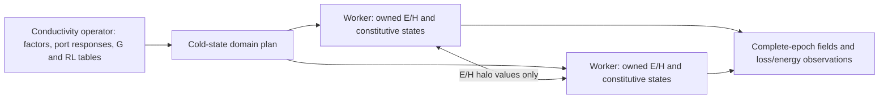

# Experimental compact-domain execution

This is a scoped C++ core interface. The
[canonical checklist](CARTESIAN_SUBGRID_CHECKLIST.md) separates implementation
from physical backend, processing and representative-antenna qualification.
The native XML/Python/Matlab engine selector remains single-device.

The bounded C++ lane additionally has physical RTX4090/RTX3080 pair evidence
in [Physical mixed-device contexts](#physical-mixed-device-contexts). This does
not extend its supported physics or qualify native distributed execution.

## Ownership, workers and transport

`CartesianSubgridDomainPlan` assigns fixed ownership from one axis and a list
of increasing internal coordinate cuts. Cuts assign work; they do not create
mesh faces. Up to 64 nonempty domains are admitted. All six magnetic
quadratures of a leaf stay together. Each coupled electric mass component
belongs entirely to one worker, so geometric assignment may move electric
edges across a cut. The plan records that count. This avoids splitting a
coupled solve; it does not guarantee balanced work.

The subsequent coupled-port increment also co-locates the complete small
Woodbury solve, its voltage/response supports and every touched mass component.
Other owned states remain distributed. This preserves the already qualified
port arithmetic; independently splitting port clusters is not implemented.

Each worker has owned-first local E/H arrays followed by read-only ghosts.
Local row remapping retains the exact operand order and split coefficients.
Ghost dependencies may fan out or cross non-neighbour workers. Only unique
owned export values are gathered, downloaded and copied into preallocated
receive buffers, then contiguous ghost ranges are uploaded. No whole-field
transfer is performed at every half-step. The plan still uses a temporary
global expanded upload during setup; production-proportional setup memory
and structured interiors remain open.

The coordinator knows only worker and transport interfaces. GPU handles and
local gathers/uploads belong in the local worker adapter, not the scheduling
logic. A reference worker runs on the CPU; this is not integration with the
optimized production CPU engine. Remote workers, MPI/RPC and asynchronous
transports are future adapters, not implemented capabilities.

At epoch n, exchange H before the E update; then exchange E at n+1 before the
H update. Workers reject missing/wrong-phase ghost acknowledgements. Full-step
observations read owned fields and scatter each global state exactly once.
Queued epochs are logical submission state, not device fences; export/owned
reads and ghost uploads finish before returning. Errors after a submission
poison the coordinator so it cannot silently continue a partially changed step.
There is no single borrowed device-field buffer for the whole domain run.

Use `FDTD/cartesian_subgrid_domains.h` from matching source headers. For example,
`CreateCartesianSubgridDomains(plan, backends)` builds local workers and a
host-staged transport. The more explicit worker/transport/coordinator factories
permit alternate adapters without putting communication choices in the core.
Backends must outlive workers. The optional `DeviceUpload` backend operation
fails closed before worker allocation when unsupported; the existing one-device
factory remains usable. This changes C++ layouts/vtables: rebuild dependent
callers/plugins with matching headers. Built-in backend tests do not qualify
plugin mode or Windows symbol export.

## Qualification scope

The [domain regression](tests/test_cartesian_subgrid_device_domains.cpp) covers
one through four logical domains, XYZ cuts, separate regions, anisotropic
ratios, nonuniform meshes, a lossless dielectric step, PEC and soft sources.
It compares complete fields with the existing one-device FP32 execution and
double CPU reference over 1500 steps. It also checks actual transfer payloads,
stale/missing exchanges, poisoned continuation, invalid uploads and unchanged
one-device operation when upload capability is absent. Physical backend
requests reject fallback rather than accepting a reference result.

The immutable local suite passes all 19 stages: CTest 23/23, Python unit modules
14/14, the prior native CPU/reference/Metal fields, ports/DC, PML, dipole,
polygons and ordinary-engine controls. Thirteen previous core/NF2FF prefixes
remain unchanged; 11,255 numerical arrays equal the frozen larger-interface
build exactly. Seven reference cases and eight physical Metal cases pass,
including mixed CPU-reference/Metal workers. Across these 1500-step domain
controls, one-device fields are identical and maximum double-reference error
is 1.62522e-6 (gate 2e-4). Missing/stale exchanges and poisoned continuation
reject. A separate ASan/UBSan domain-source control passes; LeakSanitizer is
unsupported on this macOS and no leak-sanitizer claim is made.

A separate 360,424-leaf control exercises an actual 16,384-edge mass component
across two logical Metal domains on one M5 Pro: base 8194/4/4, spacing
0.001/0.0013/0.0009m, region (2,1,1)–(8192,3,3), ratio 2/2/2 and an X cut
at 4.097 m. After 256 steps at 0.8 of the stable timestep, the one/two-domain fields
are identical, double error is 1.02301e-6 and invariant drift 1.18914e-9.
Some 32,772 electric states move owner to preserve whole coupled components.
These are functional controls, not a scaling benchmark.

Frozen local prefix: `output/openems-subgrid-domains-qualified-20261115/install`.
Configure-time source parent is `1a8f48f`, with this domain increment. Exact
source inventories, logs and identities remain in the project evidence tree:
`experiments/openems-cartesian-local-subgrid-20261112/domains/`.

- Core SHA256: `ebb022b5539b336a6b4b43b06bc1e83744b3a657ebd77d8bbb3e10489648ba53`.
- NF2FF SHA256: `87890b7ed62795695b7f81e15e3453f3c789c4f75821e5508bb1157c869c27ef`.

The same numerical source passes eight logical-domain controls on one physical
RTX3080, including mixed CPU-reference/CUDA workers, through existing HIP/nvcc.
One-device errors are zero; maximum double error is 1.62522e-6. CTest 23/23 and
single-device fields/ports/DC pass. The first attempt hit an external 300 s
CPU-test deadline; the second retains identical source/runtime/gates, runs CUDA
first and allows 900 s for CTest. Both attempts remain recorded. The final container
exited 0 without OOM, and final source/runtime hashes match. This does not
qualify physical multi-GPU, domain ports/PML or native CAD CUDA paths.

- CUDA core SHA256: `de9994d3e5a09f07de74de1effed5cc9c6371d2d7ee28bd0204d8ccdeab56c0a`.
- [CUDA reproduction scope](CARTESIAN_SUBGRID_CUDA.md#scoped-logical-domains-on-one-rtx3080).

All existing total-cell, interface-factor and refinement-alignment guards
remain. Unsupported imported non-port ledger history and malformed port
metadata reject explicitly. The original lane above did not implement PML, bulk losses/conductors,
DFT/NF2FF, collective pause/resume or native processing. The later
[prepared-conductivity increment](#prepared-conductivity-domains) extends only
its explicitly tested cold C++ constitutive path. One-device tests do not imply
broader distributed support. No throughput, representative PCB accuracy or physical
multi-GPU claim follows from logical domains on one physical device.

## Coupled resistors and source ledgers

Configure-time parent `15daf56`; the physics, source ordering and shared
point operations are unchanged. The plan retains all port rows, responses and
the small factor on one owner, with a common fixed port timestep. The initial
accumulated ledger is attributed once. A worker without a local port still
records its soft-source work using the original mass neighbours and unsolved
curl. Per-owner complete-step reads sum losses/work without copying full
fields each half-step. A partial-step ledger read rejects.

[Port-domain controls](tests/test_cartesian_subgrid_device_domain_ports.cpp)
compare three uneven logical domains with one FP32 device and double CPU:
50/75-ohm resistors, Norton drive, source-only workers, mass-coupled/repeated
soft kicks, warm accumulated history, strong DC and repeated observations.
All XYZ cuts and mixed CPU-reference/GPU workers are covered. Malformed
responses/conductances, wrong timestep and ledger phase reject. Unsupported
imported non-port history must reject instead of disappearing.

All 20 local qualification stages pass: CTest 24/24, Python modules 14/14,
retained native CPU/reference/Metal ports/DC, PML, dipole, polygons and ordinary
engines. Fourteen older runtime prefixes remain unchanged; 11,255 arrays equal
the frozen domain build exactly. Five reference and six physical Metal
port-domain cases pass. One-device fields are identical; maximum double field
error is 1.94051e-5 and energy-balance error 1.70516e-6 (gates 2e-4). Separate
ASan/UBSan domain-source controls pass; no LeakSanitizer claim.

The same numerical source passes six port-domain cases on one physical RTX3080,
including mixed CPU-reference/CUDA workers, with identical one-device fields
and the same error bounds. CTest 24/24 and retained CUDA fields/ports/DC also
pass; final source/runtime and terminal checks pass. This is three logical
workers on one physical GPU, not three physical GPUs or native distributed RF.

Frozen local prefix:
`output/openems-subgrid-domain-ports-20261116/install`.

- Core SHA256: `e2625eed13c24b9c5c07819fcc9015d0998e317a39da895adc66c5902ac00eb1`.
- NF2FF SHA256: `74c23472937c94c5c8731d9c34b0bdb8b19d8b4f7b4447e8dadd767c6af5e6bd`.
- CUDA core SHA256: `f9af217240707dba76822509402fd835c5a5a47cbbf10e4eef121d79096ef0de`.

Exact source/runtime identities, failed/passed observations and compact evidence
remain under `experiments/openems-cartesian-local-subgrid-20261112/domain-ports/`
in the project study. This does not qualify native domain selectors, distributed
PML/loss/DFT, physical heterogeneous devices, broader sources/modal ports,
production scaling or representative antenna accuracy.

## Physical mixed-device contexts

Configure-time parent `458e612`. Inspection and a four-byte physical diagnostic
showed a missing context boundary in this experimental adapter: after creating
two HIP backends on one host thread, an allocation through backend 0 belonged
to device 1. This is not a defect claim against upstream's single-device
execution contract. The frozen failing library and input are preserved.

`GPU_Backend::Activate()` selects the backend's device before a host batch.
The compact executor uses it for setup, E/H updates and observations; the local
worker uses it for halo reads/uploads and owned-field observations. HIP calls
`hipSetDevice` without adding an explicit synchronization. Reference and Metal
need no ambient selection. HIP cleanup selects the owning device too. This
adds no device-specific logic to the coordinator or transport, changes no
shared numerical operations and leaves ordinary engine loops unchanged.
Callers using the raw backend API across devices must select the matching
backend before each batch too. This is not a thread-safety guarantee for
concurrent use of one backend. Rebuild plugins and C++ clients with matching
headers/build identities.

The actual physical pair is one RTX4090 and one RTX3080, through the existing
HIP/NVIDIA backend, nvcc, SM86/SM89 and retained safe arithmetic. The diagnostic
now verifies allocation ownership and distinct readback on both devices.
The domain controls also include a deterministic ambient-context guard that
runs without a GPU. Both physical device orders pass nine field/domain and
six coupled-port cases each; a retained single-device lane passes the same
cases. Uneven cuts, XYZ, separate anisotropic regions, PEC, CPU/GPU mixtures,
source-only workers, warm ledgers, strong DC and stale/poisoned exchange guards
are retained. Fields equal the single-device control exactly, maximum double
error is 1.94051e-5, and maximum balance error is 1.70516e-6 (gates 2e-4).
CUDA CTest 24/24 and existing fields/ports/DC controls also pass, with final
source/runtime checks and container exit 0/no OOM.

All 20 local CPU/reference/Metal compatibility stages pass, including CTest
24/24, Python 14/14, native fields/ports/PML/dipole/polygons and ordinary
engines. Fifteen older core/NF2FF prefixes are unchanged, and 11,255 arrays
equal the frozen coupled-domain-port build exactly. The separate ASan/UBSan
domain-source test passes; the linked grid/library is not instrumented and
LeakSanitizer is not claimed.

A separate warmed host-only microbenchmark reports median 0.0692 microseconds
for selecting the same device and 0.0804 microseconds for alternating devices
(five rounds of 20,000 calls). It measures neither kernel execution nor
end-to-end FDTD overhead. Tests shared the hardware with an active simulation;
there is no throughput or scaling claim.

- CUDA core SHA256: `a00cf838a52f600069f1f1c9a79b3775ab40deb39760bfcc23fe581bfeb8578f`.
- Frozen local prefix: `output/openems-subgrid-physical-two-20261116/install`.
- Local core SHA256: `bc4ba82aad1f3821fbf94f68dee1983cc014a69f20df71075c1becf0959bdb29`.
- Local NF2FF SHA256: `72d50787ac38006375363a333cfae19d14ad27d2bb8772017aa1ab16aaa4d553`.
- Isolated source/build and compact evidence:
  `experiments/openems-cartesian-local-subgrid-20261112/physical-two/` in the
  project study, including the preserved failing diagnostic and terminal gates.
- Native selectors, domain PML/material histories/conductors/DFT/NF2FF,
  collective pause/resume, proportional setup memory and representative antenna
  qualification remain open. No active/frozen antenna runtime is replaced.

## Prepared conductivity domains

The r13 increment extends the bounded **C++** lane through typed conductivity
preparation. Its bounded reference/Metal and physical RTX4090/RTX3080
controls pass; it does not enable native distributed scripting,
absorber/DFT histories, collective runtime controls or antenna workflows.

The plan retains each complete implicit electric mass component on one owner.
Every conductance/surface trace must have support within that ownership; an
RL pole belongs to exactly one worker. Magnetic rates follow the six owned
quadratures of each leaf. Local recurrence views exclude ghost entries, so
constitutive operations cannot overwrite halo storage or overrun the owned RHS.
Remapping preserves operand/branch ordering and prepared coefficient pairs.
No constitutive state is exchanged or duplicated between workers.

Single-device preparation still streams curls; domains retain the existing
expanded setup representation. This changes neither the physical equations nor
the surface fits and does not solve proportional setup memory or performance.
Ports still retain their complete coupled solve on one owner. Source-only
workers record their work using the original mass and unsolved curl.

A plan may be constructed from an unadvanced
`Engine_Ext_CartesianSubgrid_Conductivity` rather than a bare grid. Its typed
package binds effective factors, resistor responses and constitutive tables
from the same preparation. Warm CPU/device histories, pending host half-steps
and additional unprepared extensions reject. This is cold initialization,
not state migration or checkpoint restart. The recurrence timestep is checked
by the coordinator before any exchange/submission, and workers must advertise
the matching prepared capability.

After a complete step, call `ReadFields(grid)` and then the paired extension's
`ReadDeviceDiagnostics(device)`. Separate complete-epoch observations expose
bulk electric/magnetic loss, surface Ohmic loss and instantaneous stored branch
energy. Summation across owners is double precision; bit-identical ledger
reduction is not promised. Partial-epoch reads reject. These new C++ layouts
and worker virtual methods require matching rebuilt callers/plugins.

[Constitutive-domain regression](tests/test_cartesian_subgrid_device_domain_loss.cpp)
checks eleven two/three-domain controls over 768 steps: XYZ assignment cuts,
zero/electric/magnetic/combined/surface-only losses, constrained traces, separate
history owners, pure-inductor branches, repeated soft kicks, source-only workers
and 50/75-ohm resistors. Three 512-step controls use native CSX copper volumes
at 18/35 micrometres with and without a lossy dielectric. The reference backend
matches one-device FP32 fields exactly; maximum double-reference field error
is 5.830e-6, constitutive ledger error 7.389e-8 and energy-balance error 2.638e-7,
within the retained 2e-4 CPU/physics gates. Full local CTest passes41/41.
Wrong timesteps, partial epochs, malformed recurrence dimensions, ghost columns,
warm preparation and unprepared absorbers reject.

Candidate prefix: `output/openems-subgrid-distributed-loss-r13-20261116/`.
Installed local core SHA256:
`f355d86377b742520112925f8f38cd0dfeed66c3724510a477254b865f6bf880`.
Source parent is `9eb7291`; the candidate's numerical source/build are locked
while physical tests run. Compact evidence remains in
`experiments/openems-cartesian-local-subgrid-20261112/lossy-materials/distributed-loss-r13/`.
The composed local replay passes19 stages, CTest41/41 and Python14/14,
with11,255 prior arrays unchanged. Fifteen Metal cases include mixed
CPU-reference/Metal workers. The physical CUDA replay passes39 gates and
CTest41/41: fifteen constitutive cases on each physical GPU and fourteen on
the RTX4090/RTX3080 pair in each order. All58 CUDA constitutive comparisons
retain identical one-device FP32 fields; maximum double field/ledger/balance
errors match the bounds above. Terminal source/runtime checks pass and the
bounded container exits0 without OOM. These are functional controls alongside
an active antenna; no speedup, general scaling or peak-VRAM claim follows.

CUDA core SHA256:
`21ab8476d5ba7845e6518bdc00743cbe3e947ffa57ea851872eb3cfc8a64c83f`.
Native distributed selectors, PML/Mur histories, DFT/NF2FF and collective
pause remain open, as do RF convergence and representative antenna acceptance.
