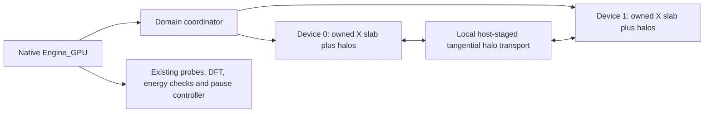

# Experimental local multi-GPU execution

Build with `ENABLE_DOMAIN_RUNTIME=ON` and a matching HIP plugin. This opt-in
adapter connects the existing domain runtime to the native `Engine_GPU` loop.
Existing single-device selection and arithmetic stay unchanged by default.

```sh
openEMS model.xml --engine=gpu --gpu-devices=0,1 -vv
```

Indices refer to the **native device list**, after container visibility has
been applied. Reserve those devices before launching. Duplicate indices,
selection together with `--gpu-device`, missing domain support and unsupported
device extensions are errors, not invitations to fall back to another GPU.

Python's existing option forwarding accepts:

```python
FDTD.Run(sim_path, engine='gpu', gpu_devices='0,1', verbose=2)
```

Matlab/Octave's existing `opts` argument accepts:

```matlab
RunOpenEMS(Sim_Path, Sim_File, '--engine=gpu --gpu-devices=0,1 -vv');
```

Use matching bindings and native libraries. When testing a changed native
class layout against old bindings, generate XML with the baseline bindings
and execute the candidate **CLI in a separate process** instead.

## Ownership and ordering



Each device uses coefficients sliced from the **same globally constructed
operator**. Equal X slabs are the default. For a fixed uneven split, set
`--gpu-domain-cuts=0,100,300` for two devices on a mesh with 300 X nodes.
Cuts are global **node indices**, with half-open ownership `[0,100)` and
`[100,300)`, in the order of `--gpu-devices`. Supply one more boundary than
devices, strictly increasing, starting at zero and ending at the actual
number of X lines. Invalid cuts fail before initializing device fields.
This is explicit placement for qualification or heterogeneous resources,
not adaptive load balancing; nodes in PML/material regions can cost more.
The default equal split and all physics/timesteps remain unchanged.
Every owned Yee location and material history has one device owner; the
two adjacent halo planes contain field values, not duplicated evolving
surface/PML states. True physical boundary conditions retain native behavior.

For each half-step the native engine runs its existing extension priority
order. It exchanges tangential halos **after** post-update and source/material
corrections. E must be available before another device updates H, and H must
be available before the next E step. The coordinator's split Begin/Finish
methods allow native extension hooks between stencil execution and exchange.

HIP implementations clip UPML regions and select excitation points, dynamic
lumped-RLC edges and opaque-surface edges by global ownership, then remap
their indices. Their constitutive equations and rounding remain native. The
first partitioned path disables fused whole-E/H and UPML-region fusion;
single-device runs retain those optimizations. A benchmark must compare with
that faster single-device baseline, not just an unfused domain executor.

## Processing and pauses

Global host views gather owned values in original NIJK order. Existing probes,
host DFT accumulation therefore use their established reference planes and
timestep schedule. Energy reduction runs on each device over the intersection
of the native prefix and its owned slab, excluding both halos; the host sums
the small partial reductions. FP32 grouping changes when a line is split,
so last-bit energy differences are possible. `test_domain_energy` checks
nonzero fields against a host sum, including prefixes before/on/after a cut;
`tests/manual/domain_energy.py` checks a one/two-GPU energy-selected stop.
Device-only DFT sums are not implemented in this adapter yet. No per-timestep
full-field host fallback is allowed for real GPU extensions. The CPU reference
backend deliberately allows host extensions for numerical testing.

All local device work and halo completions finish before a native processing
boundary returns. The existing startup/runtime pause and decay-gate mechanisms
then pause the **whole run**, with every device's fields and histories retained.
The external controller can export DFT sums, calculate NF2FF and continue.
This is an in-memory pause, not a disk restart checkpoint.

## Limits and qualification

- Cartesian X slabs on one host. HIP targets physical devices; the Metal
  domain executor is qualified with separate queues on one physical GPU.
  The normal Metal plugin still exposes only its default device. Mixed
  CPU/GPU native execution, cylindrical grids and subgrids are unsupported.
- Only excitation, UPML, lumped RLC and opaque-surface device extensions are
  admitted. Single-device support for an extension is not domain support:
  Mur, dispersive materials, TFSF and sinusoidal steady-state detection are
  rejected until their indexing, ownership and reductions are integrated.
- The neutral plan/executor/transport core remains independent of device APIs.
  Existing MPI transport tests do not qualify MPI antenna execution through
  this native adapter. Multi-host ownership of sources, processing and control
  still needs integration.
- Device fields, coefficients and owned material state scale with each slab
  plus halos. **Host operator construction and the native host mirror are
  still global**; splitting across GPUs does not remove the host-RAM limit.
- Communication uses host staging with explicit completions. There is no P2P,
  MPI, transfer overlap or adaptive weighted split in this initial adapter.
- Small numerical regression success does not establish full antenna
  convergence, material validity or a speedup. Preserve frozen single-device
  studies and qualify the actual input, meshes and build before adopting it.

`tests/manual/domain_backend.py` compares nonzero complex E/H and a probe on a
cut for one/two/three reference domains and one/two real GPUs. Fixtures include
PML, sources spanning a cut, physical PEC boxes, dynamic RLC and a passive
opaque conductor. The maximum absolute error normalized by each reference
array's peak must be below `1e-5`; timestep columns must match exactly.

The one/two-device energy-stop fixture uses this same peak-normalized gate.
It does not reuse startup qualification's stricter elementwise comparison,
which compares repeated executions of the same kernel path. Fused and
partitioned kernels can differ near a field null without exceeding the
cross-device error bound. Probe timestamps and selected stop steps still
match exactly; zero-reference arrays must remain exactly zero. Focused tests
reject significant errors, nonfinite values and shape mismatches.

`tests/manual/runtime_gates.py --solver-option=--gpu-devices=0,1` checks automatic
and manual pause/snapshot/continue, timeout, stop, abort and stale-ID rejection
against an uninterrupted run. These tests use public small fixtures, not
project antenna geometry or supplier data.

## Local Metal qualification without multiple physical GPUs

With `ENABLE_METAL=ON`, `ENABLE_DOMAIN_RUNTIME=ON` and
`OPENEMS_DOMAIN_TESTS=ON`, the build creates a **test-only** plugin under
`<build>/test-plugins`. It exposes three explicitly labelled logical devices
on the same physical Metal GPU, each with its own queue, buffers and material
histories. It is never installed or placed in the normal plugin directory.
Set `OPENEMS_PLUGIN_PATH=<build>/test-plugins` only for these manual tests.
Without that override, normal device discovery and duplicate-ID rejection
remain unchanged. This exercises native GPU kernels and the shared domain
coordinator; it does not measure physical multi-GPU speedup or PCIe transfer.

Generate fixtures with matching baseline Python bindings and run the candidate
CLI as a child process:

```sh
OPENEMS_PLUGIN_PATH=<build>/test-plugins python tests/manual/domain_backend.py \
  --binary <build>/openEMS --engine gpu --device-counts 2,3 --output <new-output>
OPENEMS_PLUGIN_PATH=<build>/test-plugins <build>/test_domain_energy \
  <new-output>/pec-1/model.xml metal-domain-test
OPENEMS_PLUGIN_PATH=<build>/test-plugins python tests/manual/runtime_gates.py \
  --binary <build>/openEMS --engine gpu --solver-option=--gpu-devices=0,1 \
  --output <new-runtime-output>
```

Metal clips PML and owns sources, RLC histories and opaque edges like HIP.
Its domain energy reduction excludes halo planes; the single-device reduction
still starts at X=0. PML fusion is disabled for domains and remains unchanged
for ordinary single-device execution. Mur, steady-state detection and other
unmapped extensions are rejected by the same native guard.

Python forwards `gpu_domain_cuts='0,100,300'` with `gpu_devices='0,1'`;
Matlab passes `--gpu-domain-cuts=0,100,300` in the same `opts` string.
`tests/manual/domain_cuts.py` compares deliberately uneven two/three-domain
partitions with an unsplit control, including one-node outer/interior slabs
and PML/source/material intersections. It also rejects malformed, overlapping,
incomplete and overflowing cuts instead of silently selecting equal slabs.

The physical lower-X current ghost is copied within the owning device through
an optional ordered `CopyRange` operation. HIP uses a stream-ordered D2D copy;
Metal uses its existing command encoder. This removes two D2H and two H2D
plane transfers per timestep for that boundary, retaining the synchronization
and a staged fallback for backends without the operation. It does not remove
inter-device halo staging. `test_domain_copy` checks queued dependent E/H
copies, unchanged other locations, local/unsplit storage, empty/identical
ranges and rejected overlap/overflow. The physical CUDA measurements below
cover the current implementation; fewer transfers alone is not a speedup claim.

## Physical CUDA qualification, 25 October 2026

Native code at `30f3799` passes the four nonzero source/PML, PEC, RLC and
opaque-conductor fixtures on two RTX3080s. Maximum field error is below
`8.11e-7` of reference peak; the probe samples are unchanged. Owned-prefix
energy, uneven cuts, ordered copies and automatic/manual/startup control tests
pass. One/two-device energy-selected stopping is380steps at−50dB; the final
complex-field difference is `7.34e-7` of reference peak, with unchanged probes.
The cross-device comparison correction is test-only; native binaries did not
change. This remains bounded fixture evidence, not full-antenna validation.

The disclosed Gaussian derivative of `benchmark/cases.py` replaces
`SetSinusExcite(f0)` with `SetGaussExcite(f0, f0/2)` in `_setup` and identifies
the case version separately. A sinusoidal steady-state extension is unsupported
in this adapter and is not counted as a successful standard benchmark. All
other PML geometry, probes and interleaved timing follow `benchmark/bench.py`.
Each row uses three interleaved3second samples and two native CPU threads:

| Native grid | One fused RTX3080 [Mcells/s] | Two host-staged RTX3080s [Mcells/s] | Two/one |
|---|---:|---:|---:|
| 200³ =8M |6908.3|5476.6|0.793 |
| 311³ =30.08M |7359.4|7336.0|0.997 |

Measured on a dual Xeon Gold5218 with346GiB RAM, CUDA12.6 and two10GiB
RTX3080s on different NUMA nodes. Probe prefixes compare identically. At30M
the0.3% difference is within the measured spread; neither size demonstrates
an application speedup. Larger-model, topology and material costs require
separate measurement. Inter-device staging, synchronization, unfused domain
updates and global host processing remain limitations.
