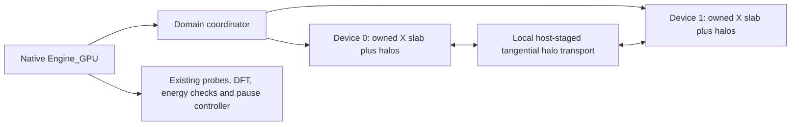

# Experimental local multi-GPU execution

Build with `ENABLE_DOMAIN_RUNTIME=ON` and a matching HIP plugin. This opt-in
adapter connects the existing domain runtime to the native `Engine_GPU` loop.
Existing single-device selection and arithmetic stay unchanged by default.

```sh
openEMS model.xml --engine=gpu --gpu-devices=0,1 -vv
```

Indices refer to the **native device list**, after container visibility has
been applied. Reserve those devices before launching. Duplicate indices,
selection together with `--gpu-device`, missing domain support and unsupported
device extensions are errors, not invitations to fall back to another GPU.

Python's existing option forwarding accepts:

```python
FDTD.Run(sim_path, engine='gpu', gpu_devices='0,1', verbose=2)
```

Matlab/Octave's existing `opts` argument accepts:

```matlab
RunOpenEMS(Sim_Path, Sim_File, '--engine=gpu --gpu-devices=0,1 -vv');
```

Use matching bindings and native libraries. When testing a changed native
class layout against old bindings, generate XML with the baseline bindings
and execute the candidate **CLI in a separate process** instead.

## Ownership and ordering



Each device uses coefficients sliced from the **same globally constructed
operator**. Equal X slabs are a first implementation, not load balancing.
Every owned Yee location and material history has one device owner; the
two adjacent halo planes contain field values, not duplicated evolving
surface/PML states. True physical boundary conditions retain native behavior.

For each half-step the native engine runs its existing extension priority
order. It exchanges tangential halos **after** post-update and source/material
corrections. E must be available before another device updates H, and H must
be available before the next E step. The coordinator's split Begin/Finish
methods allow native extension hooks between stencil execution and exchange.

HIP implementations clip UPML regions and select excitation points, dynamic
lumped-RLC edges and opaque-surface edges by global ownership, then remap
their indices. Their constitutive equations and rounding remain native. The
first partitioned path disables fused whole-E/H and UPML-region fusion;
single-device runs retain those optimizations. A benchmark must compare with
that faster single-device baseline, not just an unfused domain executor.

## Processing and pauses

Global host views gather owned values in original NIJK order. Existing probes,
host DFT accumulation and energy processing therefore use their established
reference planes and timestep schedule. Device-only DFT/energy reductions are
not implemented in this adapter yet; no per-timestep full-field host fallback
is allowed for real GPU extensions. The CPU reference backend deliberately
allows host extensions for numerical testing.

All local device work and halo completions finish before a native processing
boundary returns. The existing startup/runtime pause and decay-gate mechanisms
then pause the **whole run**, with every device's fields and histories retained.
The external controller can export DFT sums, calculate NF2FF and continue.
This is an in-memory pause, not a disk restart checkpoint.

## Limits and qualification

- Cartesian X slabs on one host; HIP initially. Metal domain initialization,
  mixed CPU/GPU native execution, cylindrical grids and subgrids are unsupported.
- Only excitation, UPML, lumped RLC and opaque-surface device extensions are
  admitted. Single-device support for an extension is not domain support:
  Mur, dispersive materials, TFSF and sinusoidal steady-state detection are
  rejected until their indexing, ownership and reductions are integrated.
- The neutral plan/executor/transport core remains independent of device APIs.
  Existing MPI transport tests do not qualify MPI antenna execution through
  this native adapter. Multi-host ownership of sources, processing and control
  still needs integration.
- Device fields, coefficients and owned material state scale with each slab
  plus halos. **Host operator construction and the native host mirror are
  still global**; splitting across GPUs does not remove the host-RAM limit.
- Communication uses host staging with explicit completions. There is no P2P,
  MPI, transfer overlap or adaptive weighted split in this initial adapter.
- Small numerical regression success does not establish full antenna
  convergence, material validity or a speedup. Preserve frozen single-device
  studies and qualify the actual input, meshes and build before adopting it.

`tests/manual/domain_backend.py` compares nonzero complex E/H and a probe on a
cut for one/two/three reference domains and one/two real GPUs. Fixtures include
PML, sources spanning a cut, physical PEC boxes, dynamic RLC and a passive
opaque conductor. The maximum absolute error normalized by each reference
array's peak must be below `1e-5`; timestep columns must match exactly.

`tests/manual/runtime_gates.py --solver-option=--gpu-devices=0,1` checks automatic
and manual pause/snapshot/continue, timeout, stop, abort and stale-ID rejection
against an uninterrupted run. These tests use public small fixtures, not
project antenna geometry or supplier data.
